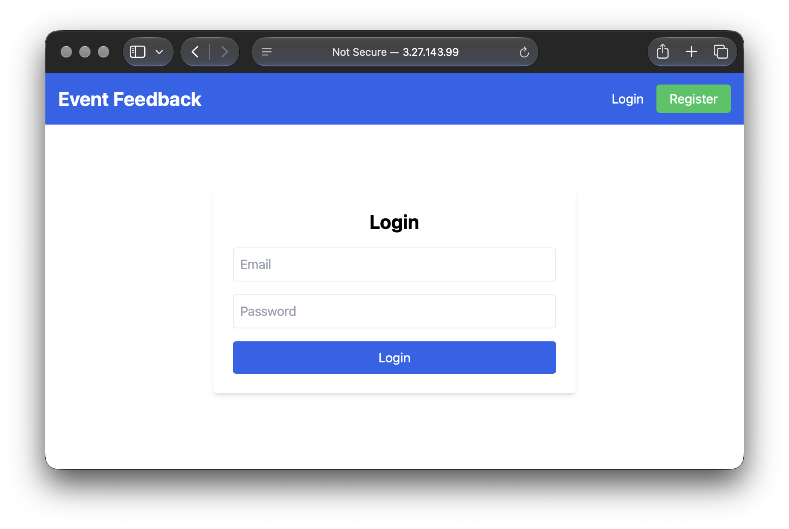
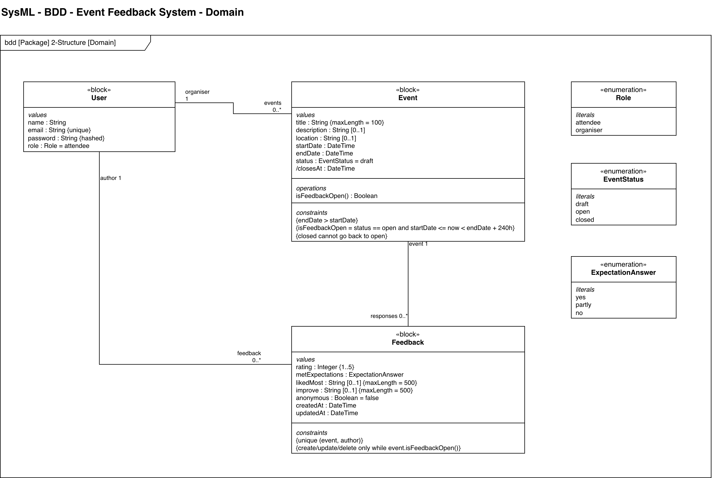
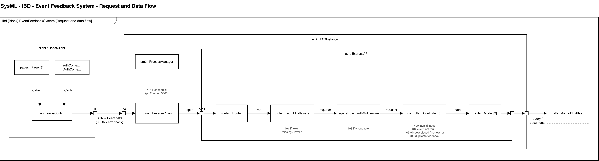

# Event Feedback System

## Project Description

The Event Feedback System is a MERN app where event organisers create events, and open them for feedback. Attendees then leave a rating, and comments on events they went to.

This application is forked from the unit's task manager starter project.

## Live App

### Accessing The App

**Live App (EC2):** [http://3.27.143.99/](http://3.27.143.99/)



### Known Deployment Limitation

- The uni provided AWS EC2 instance doesn't allow use of an Elastic IP, so the public IP address changes whenever the instance is stopped and started.
- Additionally the instances are set to stop automatically at midnight daily.
- As such the IP address above is current as of 14-Nov-2026.
- If the application does not load, the new IP address needs to be added to this doc, and whitelisted within the MongoDB Atlas.

## Setup

### Local

#### Prerequisites

Download, install and verify:

1. Node.js >=20.0.0 - [install link](https://nodejs.org/en/download)

2. npm - [install link](https://docs.npmjs.com/downloading-and-installing-node-js-and-npm)
    - Verify installs

        ```bash
        node -v
        npm -v
        ```

3. MongoDB
    - Either locally - [install link](https://www.mongodb.com/docs/manual/installation/) or,
    - Remotely via [Atlas](https://www.mongodb.com/products/platform/atlas-database)

#### Steps

1. Clone the repo, and install packages

    ```bash
    git clone https://github.com/xdaybreakerx/IFQ636-A1.git
    cd IFQ636-A1
    npm run install-all
    ```

2. Create `backend/.env` by copying `backend/.env.example` and fill in:

- `MONGO_URI` - your Mongo connection string
- `JWT_SECRET` - a random long string
    - or generate:
        ```bash
        openssl rand -base64 32
        ```
- `PORT` - default `5001` - the frontend proxies to this
    - changeable for deployment - see below
- `ORGANISER_EMAIL`, `ORGANISER_PASSWORD`, `ATTENDEE_EMAIL`, `ATTENDEE_PASSWORD` - logins for the seed data

3.  Seed the database

    **WARNING**

    The seed functions fully drop the existing database - do not use in prod

    ```bash
    npm run reset --prefix backend
    ```

    **INFO**

    New accounts made through the register page are attendees. The organiser accounts come via the seed data.

4.  Run the app (backend and frontend)

    ```bash
    npm run dev
    ```

5.  Access the app

- frontend: http://localhost:3000
- backend: http://localhost:5001/api

### Tests

The API tests are provided via Postman through `postman/collections/`.

Backend unit tests with Mocha:

```bash
npm test --prefix backend
```

## Deployment (manual)

CI/CD is out of scope for this assignment. Deployment is done manually over SSH.

#### First setup

1. Following the University guidelines - launch an Ubuntu EC2 instance in Sydney using the provided security groups, subnet, and the IFQ636-EC2-Role instance profile. Security group inbound rules: SSH (22) from my IP only, HTTP (80) from anywhere.
2. Add the instance's public IP to MongoDB Atlas Network Access whitelist.
3. SSH in and install required tools:

    ```bash
    sudo apt update && sudo apt upgrade
    sudo apt install git nodejs npm nginx -y
    sudo npm install -g pm2
    ```

4. Clone the repo, install packages, and create `backend/.env` on the server.

    ```bash
    cd ~
    git clone https://github.com/xdaybreakerx/IFQ636-A1.git
    cd ~/IFQ636-A1
    npm run install-all
    cd ~/IFQ636-A1/backend
    touch .env
    nano .env
    ```

5. Start the backend and build and serve the frontend.

    ```bash
    cd ~/IFQ636-A1/backend
    pm2 start "npm run start" --name backend

    cd ../frontend
    npm run build
    pm2 serve build/ 3000 --name frontend --spa
    pm2 startup && pm2 save
    ```

6. Configure nginx to send `/api/` to port 5001 and `/` to port 3000

    bash:

    ```bash
    # nginx config requires sudo as its owned by root
    sudo nano /etc/nginx/sites-available/default
    ```

    configuration:

    ```nginx
    server {
        listen 80;
        server_name _;

        location /api/ {
            proxy_pass http://localhost:5001;
        }

        location / {
            proxy_pass http://localhost:3000;
        }
    }
    ```

7. Reload nginx

    ```bash
    sudo nginx -t && sudo systemctl reload nginx
    ```

#### Updating

Changes are made locally and merged into main on GitHub, never edited on the server.

To update on the server:

```bash
cd ~/IFQ636-A1
git pull
# OR
# git fetch --tags && git checkout {version}
cd backend && npm ci && pm2 restart backend
cd ../frontend && npm ci && npm run build && pm2 restart frontend
pm2 list
```

## Architecture

The app keeps the starter project's MVC structure.

SysML diagrams are exported from draw.io, with sources in `/docs/diagrams`

#### Backend

The backend is split into models, controllers, and routes.

- **Models:** `User` (role is `organiser` or `attendee`), `Event` (status `draft` / `open` / `closed`), `Feedback` (linked to an event and a user).
- **Routes:** `/api/auth`, `/api/events`, `/api/feedback`
- **Middleware:** `protect` checks the JWT, `requireRole` limits a route to organisers or attendees.



#### Frontend

The React frontend stores the logged in user in Context and uses `ProtectedRoute` to stop users opening other roles pages. User tokens are stored in local storage.

#### Deployment

On EC2 nginx serves on port 80. `/api` requests are sent to the Express backend on port 5001, everything else is sent to the React build on port 3000. Both run under pm2.



#### Tech Stack

- Database: MongoDB Atlas
- Backend: Node.js, Express, Mongoose, JWT auth
- Frontend: React (Create React App), Tailwind, axios
- Testing: Mocha + Chai (backend), Postman
- Deployment: AWS EC2 (Ubuntu), pm2, nginx

## Known Limitations

- HTTP only, no HTTPS or domain name.
- Organiser accounts can only be created through the seed script, not the register page.
- Automated tests only cover the backend (some Mocha unit tests plus the Postman collection). There are no frontend tests.
- Deployment is manual, no CI/CD.
